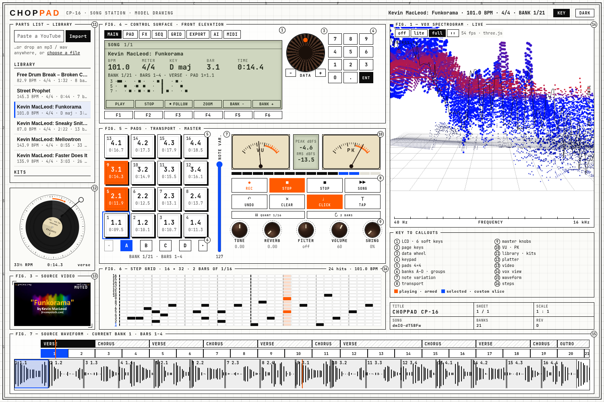

# ChopPad

A browser sampling workstation for chopping songs onto drum pads. Paste a YouTube link or drop an audio file, and ChopPad finds the tempo, cuts the song into chops on a 4×4 pad grid, and lets you play, sequence, shape and export them. It runs entirely on your own machine.



## What it does

- **Import** a YouTube link or a local audio/video file (up to 7 minutes).
- **Chop** by tempo grid (1/4, 1/8, 1/16) or by transients, with tempo, meter and key detection.
- **Play** 16 pads per bank from the keyboard, mouse, touch or a MIDI controller; the source video follows the chop being played.
- **Shape** each pad: gain, pitch, envelope, filter, reverse, mute groups, time-stretch, 16 levels. Master FX on the output.
- **Sequence** with a step grid, live recording, quantize and swing, several patterns chained into a song.
- **Drum pad mega banks**: your pads, sounds, sequence and tempo live in a mega bank, not in the song. Load another song and keep the pads you used, or start a new mega bank.
- **Export** WAV, MIDI, SFZ, a zip of chops, or a Hydrogen drum kit; open the current bank straight in Hydrogen.
- **Agent control**: a command line and an MCP server, so an AI agent can do everything the screen can. See [`docs/agent-control.md`](docs/agent-control.md).

## Run it

Needs [uv](https://docs.astral.sh/uv/) and Python 3.12+, plus `ffmpeg` and `node` on your PATH (yt-dlp uses node for YouTube).

```bash
git clone https://github.com/kyl-er/choppad && cd choppad
uv sync
./choppad --serve            # then open http://127.0.0.1:8960
```

Import from the page, or from the shell: `./choppad "https://www.youtube.com/watch?v=..." --serve`.

On Windows use `choppad.cmd --serve` in place of `./choppad --serve` (or `uv run python components/integrate/choppad.py --serve`). The app itself is developed and tested on Linux; on Windows the importer, pads, sequencer and exports to files are expected to work, while the Hydrogen/Ardour bridge and the virtual MIDI port are Linux-only.

If the page ever sits on "Loading…": check that you are on the `v4` branch (`git branch --show-current`), and hard-reload the tab.

Optional tools, used only by the features that name them:

| Tool | Used for |
|---|---|
| `rubberband` | time-stretch and fit-to-tempo |
| Hydrogen (`hydrogen`, `h2cli`) | "Open in Hydrogen", kit install |
| Ardour 9 | session export |

## Ports and settings

Nothing here is required; the defaults work on their own.

| Setting | Default | What it is |
|---|---|---|
| `--port` | `8960` | the web app and its API (binds to 127.0.0.1 only) |
| `CHOPPAD_SERVER` | `http://127.0.0.1:8960` | server the CLI verbs and the MCP server talk to |
| `CHOPPAD_REPO` | this folder | where `media/` (the song library and mega banks) lives |
| `CHOPPAD_LLM_URL`, `CHOPPAD_LLM_MODEL`, `CHOPPAD_LLM_KEY` | OpenRouter | optional "Analyze with AI"; point it at any OpenAI-compatible endpoint |
| `CHOPPAD_STEMS_BACKEND`, `CHOPPAD_STEMS_URL` | off | optional remote stem separation |
| `CHOPPAD_HYDROGEN_DIR`, `CHOPPAD_DAW_DIR` | Hydrogen's user folder, `~/.local/state/choppad/daw` | where kits go and where the DAW bridge keeps its private config |
| `CHOPPAD_E2E_PYTHON` | `/usr/bin/python3` | a Python with Playwright, for the browser tests |

The Hydrogen bridge starts its own Hydrogen with a private config and its own OSC port; it never edits your Hydrogen settings.

## Layout

```
components/   ingest, rhythm, chop, export, stems, daw, control (CLI + MCP), integrate (server), ui (browser)
contracts/    the data and action contracts every part builds to
tests/e2e/    browser tests (Playwright) on real songs
tools/        status.py runs every suite in dependency order
docs/         plan (PRD-v4), design directions and screenshots, agent control, DAW bridge notes
```

Tests: `PATH="$PWD/.venv/bin:$PATH" python3 tools/status.py`. The browser suites need a few songs in `media/` and skip without them.

## Branches

- `v4` (default): the current workstation described above, including the drum pad mega banks and the import link fix.
- `master`: the earlier version 3. `v4` has not been merged into it yet.

## Notes

`media/` is never committed: songs you import stay on your machine. Vendored in `components/ui/vendor/`: [wavesurfer.js](https://github.com/katspaugh/wavesurfer.js) (BSD-3-Clause) and [three.js](https://github.com/mrdoob/three.js) (MIT). `AGENTS.md`, `opencode.json` and `tools/heartbeat.sh` / `tools/agbridge.py` describe the author's own agent workflow and are not needed to run the app.
