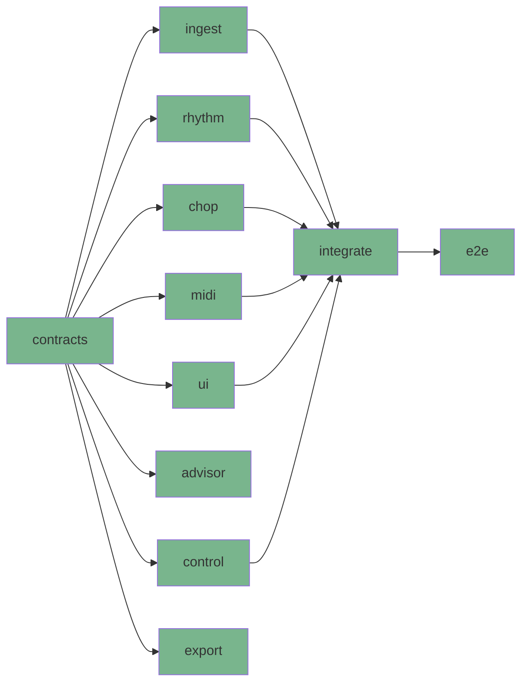

# ChopPad test status — 2026-11-22 12:15

Generated by `tools/status.py --vault`. Do not edit by hand.

| component | owner | depends on | pass | state | first failure |
|---|---|---|---|---|---|
| contracts | orchestrator | — | 11/11 | GREEN | `` |
| ingest | agent-ingest | contracts | 9/10 (+1 skip) | GREEN | `` |
| rhythm | agent-rhythm | contracts | 9/9 | GREEN | `` |
| chop | agent-chop | contracts | 11/11 | GREEN | `` |
| midi | agent-midi | contracts | 14/14 | GREEN | `` |
| ui | agent-ui | contracts | 54/54 | GREEN | `` |
| advisor | agent-advisor | contracts | 10/10 | GREEN | `` |
| control | agent-control | contracts | 35/35 | GREEN | `` |
| export | agent-export | contracts | 6/6 | GREEN | `` |
| integrate | agent-integrator | ingest, rhythm, chop, midi, ui, control | 3/3 | GREEN | `` |
| e2e | orchestrator | integrate | 3/3 | GREEN | `` |

