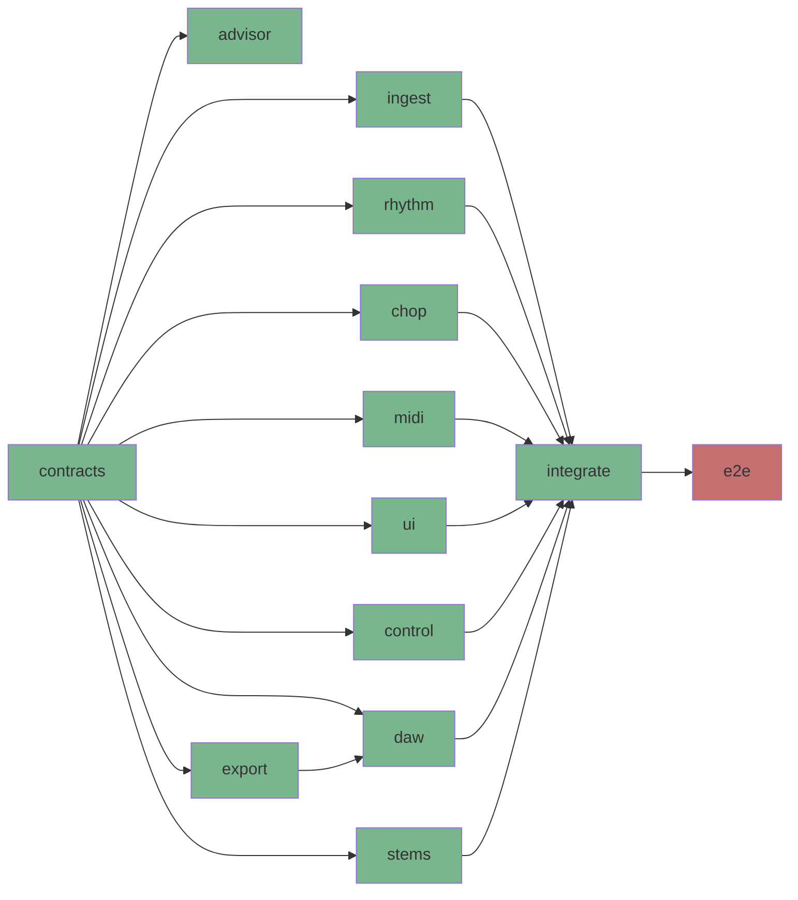

# ChopPad test status — 2026-11-22 15:52

Generated by `tools/status.py --vault`. Do not edit by hand.

| component | owner | depends on | pass | state | first failure |
|---|---|---|---|---|---|
| contracts | orchestrator | — | 11/11 | GREEN | `` |
| ingest | agent-ingest | contracts | 10/11 (+1 skip) | GREEN | `` |
| rhythm | agent-rhythm | contracts | 12/12 | GREEN | `` |
| chop | agent-chop | contracts | 23/23 | GREEN | `` |
| midi | agent-midi | contracts | 14/14 | GREEN | `` |
| ui | agent-ui | contracts | 136/136 | GREEN | `` |
| advisor | agent-advisor | contracts | 10/10 | GREEN | `` |
| control | agent-control | contracts | 71/71 | GREEN | `TimeoutError: timed out` |
| stems | agent-sampler | contracts | 11/11 | GREEN | `` |
| export | agent-export | contracts | 30/30 | GREEN | `` |
| daw | agent-daw | contracts, export | 110/115 (+5 skip) | GREEN | `` |
| integrate | agent-integrator | ingest, rhythm, chop, midi, ui, control, daw, stems | 24/24 | GREEN | `` |
| e2e | orchestrator | integrate | 44/46 (+1 skip) | RED | `AssertionError: ['http://127.0.0.1:54737/api/jobs/4690ce5e061e'] is not false : the stream is used; polling is` |

