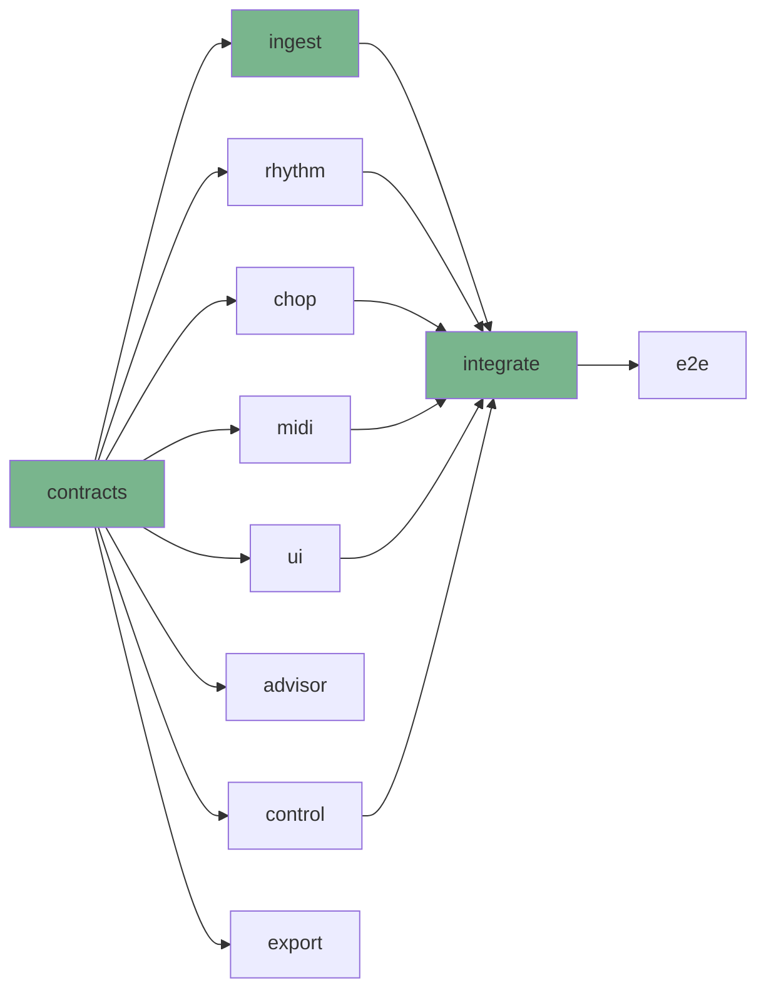

# ChopPad test status — 2026-11-22 12:32

Generated by `tools/status.py --vault`. Do not edit by hand.

| component | owner | depends on | pass | state | first failure |
|---|---|---|---|---|---|
| contracts | orchestrator | — | 11/11 | GREEN | `` |
| ingest | agent-ingest | contracts | 9/11 (+2 skip) | GREEN | `` |
| integrate | agent-integrator | ingest, rhythm, chop, midi, ui, control | 9/9 | GREEN | `` |

