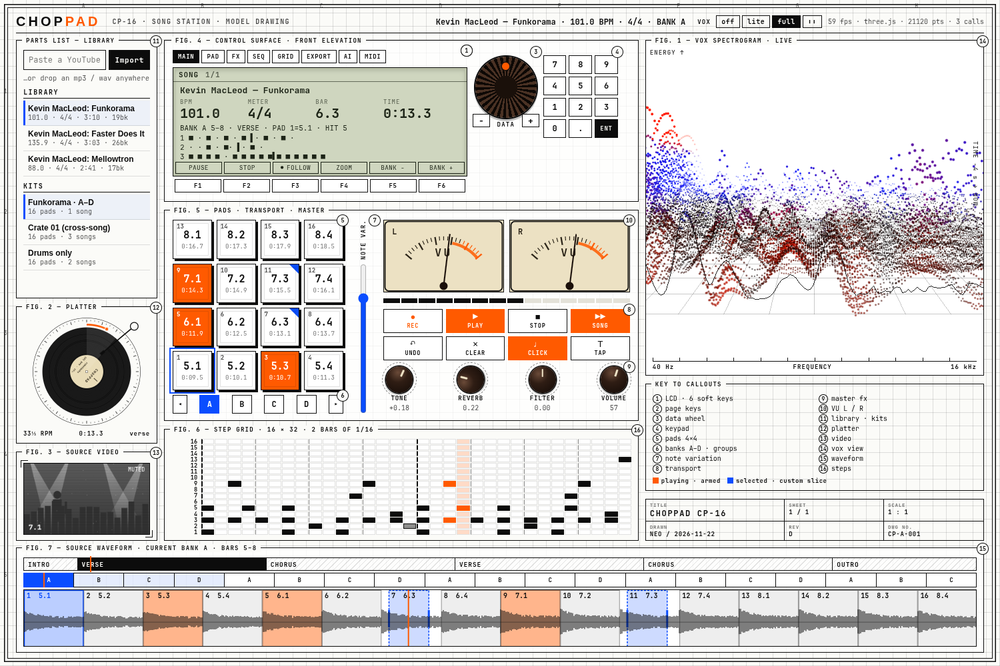
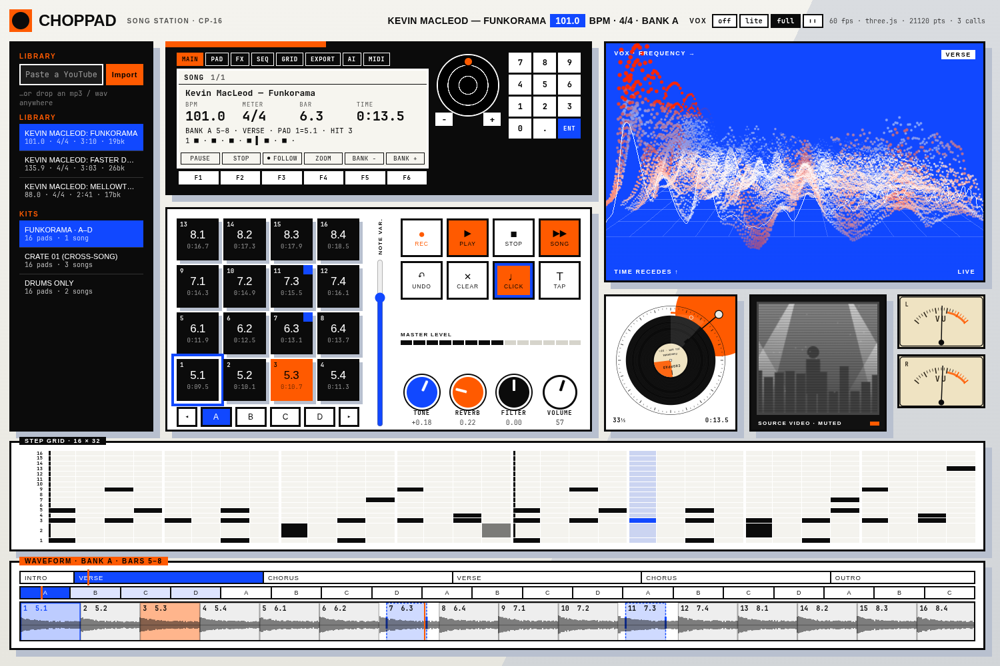
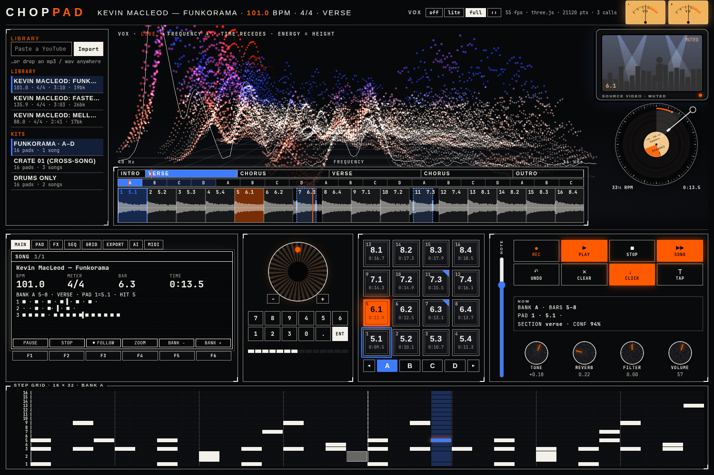

# ChopPad Station: three design directions

Static, self-contained mock-ups. Nothing here touches `components/`; the real app is unchanged. neo picks one (PRD-v4 §8.5) and W4 steps 3-5 build it.

## How to view

```
cd docs/design && python3 -m http.server 8999 --bind 127.0.0.1
# open http://127.0.0.1:8999/direction-a.html  (or -b, -c)
```
- Served over http the vox view is real three.js. Opened from `file://`, browsers block the ES-module import, so each page automatically falls back to a 2D-canvas particle view (checked: `file://` loads, no errors, 96x64 points). The fallback is a safety net, not a design target.
- URL flags: `?q=off|lite|full` (start quality), `?noauto` (disable the automatic drop to lite, used for screenshots), `?fallback=1` (force the 2D view).
- Vendored: **three.js r170 (0.170.0)**, `https://cdn.jsdelivr.net/npm/three@0.170.0/build/three.module.min.js`, 691 KB, MIT, saved as `vendor/three.module.min.js`. No other external request at view time: system fonts only, no images.
- Interaction (all three): pads by click and keys `Z X C V / A S D F / Q W E R / 1 2 3 4`; page keys (MAIN PAD FX SEQ GRID EXPORT AI MIDI) and soft keys (click or `F1`-`F6`); data wheel by drag, mouse wheel or `+`/`-`; keypad digits + `ENT` set the highlighted LCD value; knobs by drag, wheel, arrows, double-click resets; step grid cells toggle (shift = soft hit); bank keys, bank strip, section strip and waveform regions are clickable; `Space` plays/pauses the song, `P` pattern, `B` rec, `T` tap. Everything is fake: a looping 2-bar beat (101 BPM, kick/snare/hat/open-hat/bass/stab/vox/fx envelopes) drives pads, step cursor, VU, vox view, platter and the "video". Hitting a pad adds to it; drawing steps changes the loop.
- `prefers-reduced-motion: reduce` starts with all motion paused (frozen but populated frame; the `❚❚` button resumes). Verified by emulation: step counter does not advance.

Files: `direction-{a,b,c}.html` (about 80 KB each, the same ~700-line behaviour core inlined, different markup and CSS), `shots/direction-{a,b,c}.png` (1500x1000) and `-1080.png` (1920x1080), `vendor/`.

## Shared decisions (all three)

**Colour logic.** White and black do the structure; the two highlighters mean state, in every direction:
- **Orange** = in time / live: pad hit, playing transport, armed REC, playhead, step cursor firing, hottest particle peaks, section "chorus".
- **Blue** = in place / chosen: selected pad, current bank, custom slice, current section "verse", knob/tone, mid-energy particles.

**Where the video lives.** The muted song video is a small framed window (A: figure beside the platter; B: black monitor beside the platter; C: CRT billboard in the skyline). It cuts to the chop being played (the mock-up draws procedural footage that jumps on each hit and prints the chop label). Reason not to put it inside the LCD: the LCD must stay mono and fast, and the video is a reference, not a control.

**LCD pages and soft keys** (identical in all three; this is the hardware answer to "where do the other 40 controls live"). Eight page keys; pressing the active page key again cycles its sub-pages. F1-F6 either trigger (act), toggle (bool, shows a dot) or select a field (num/enum); the data wheel / `+ -` / arrow keys / keypad then edit the selected field; on MAIN the wheel is master volume.

| Page key | Sub-pages | F1 F2 F3 F4 F5 F6 |
|---|---|---|
| MAIN | 1 | PLAY/PAUSE · STOP · FOLLOW · ZOOM · BANK- · BANK+ (screen shows title, BPM, meter, bar.beat, time, bank/bars/section, pad=chop, 3 mini step rows) |
| PAD | 1 sound | GAIN · PITCH · ATTACK · RELEASE · REVERSE · MODE (inspector for the selected pad) |
| | 2 slice | GRAB (from playhead) · RESET SLICE · COPY ALL · RESET SND |
| | 3 global | MODE · CHOKE · FULL LVL |
| FX | 1 | TONE · REVERB · SIZE · FILTER · PRESET (Dry, Dusty, Hall, Tape, Lo-fi, Wide) · RESET |
| | 2 | LOW · MID · HIGH (3-band EQ) |
| SEQ | 1 | REC · PATTERN · CLICK · BARS (1/2/4) · QUANT (off/1/8/1/16) · SWING |
| | 2 | REPEAT · RATE · UNDO · CLEAR · .MID · .WAV |
| GRID | 1 | GRID (1/4,1/8,1/16) · METER (2/4,3/4,4/4) · TEMPO/2 · TEMPOx2 · BEAT-1 · BEAT+1 |
| | 2 | BAR1=LAST · TAP · APPLY · TEMPO (numeric, keypad-enterable) |
| EXPORT | 1 | > HYDROGEN · > SFZ · .MID · .WAV |
| AI | 1 | ANALYZE · LOAD BANK (result line on the LCD) |
| MIDI | 1 | LEARN · RESET MAP (device list on the LCD) |

**Always-physical controls (never behind a page):** 4x4 pads with chop label (bar.beat) and time, bank keys A-D plus group arrows, bank strip (all 19 banks) and section strip, note-variation slider, transport cluster (REC, PLAY pattern, STOP, SONG, UNDO, CLEAR, CLICK, TAP), knobs TONE / REVERB / FILTER / VOLUME, data wheel, numeric keypad, VU needles L/R plus LED ladder, library with URL import and kits, platter, video, vox view, waveform with slice regions, 16x32 step grid. Banks: the hardware has four bank keys, ChopPad has 19 banks, so A-D select within a group of four and the arrows move the group; the bank strip jumps anywhere.

**Checklist against the v3 template (`components/ui/ui.js`).** LCD title/BPM/meter/pos/clock/confidence; master volume (knob, and wheel on MAIN) and meter (VU + LEDs); video; pads; bank prev/next; FX tone/reverb/presets/size/filter/EQ; sections strip; bank strip; waveform; song play/stop/follow/zoom; sequencer rec/play/click/bars/quantize/swing/note repeat/undo/clear/.mid/.wav; step grid; grid, meter, tempo tools, tap tempo + apply, set bar 1; pad mode/choke/full level; inspector gain/pitch/attack/release/reverse/mode/grab/reset slice/copy to all/reset sound; AI analyze + load bank; export Hydrogen + SFZ; MIDI devices + learn + reset map; URL import and file drop hint; keyboard hint. All present in all three. Not mocked: the import job progress list, the AI output text beyond one line, MIDI device hot-plug.

**Accessibility.** Every control is a real `button`, a labelled slider (`role=slider`, arrow keys) or a range input; focus ring is 2 px in the direction's blue (offset 2 px). LCD text is 11-13 px mono at 7:1 or better (A: #1c2316 on #cfd6bf; B: #0b0b0b on #f6f5ef; C: #f3f1ea on #040506). Smallest labels are 7.5-9 px (step-grid row numbers, tick captions); this is the known readability floor and the spot the build should enlarge if neo wants it. The step grid cells are pointer-first in the mock-up (no roving keyboard focus yet); the real build should add arrow-key navigation. Decorative canvases (vox, platter, video) are `aria-hidden` or labelled.

**Particle view (all three, one shared implementation).**
- Frequency along X (192 bins at full), time receding in Z (110 rows, 24 rows/s = about 4.5 s of history), energy as height and brightness. Colour ramp: ink to blue at mid energy to orange at peaks; the blue/orange mid colour follows the section (verse blue, chorus orange). Pad hits spawn travelling ripples at the pad's frequency position (8 ripples, max); a kick lifts the low bins and nudges the camera.
- **Budget, full: 192 x 110 = 21,120 points, 3 draw calls** (one `Points` with a vertex-texture height field, one front-row `Line`, one floor-grid `LineSegments`). **Lite: 80 x 48 = 3,840 points, 3 draw calls**, point size scaled up, pixel ratio 1. Off: canvas hidden, no work. The heights live in a ring-buffered `R32F` DataTexture (one row written per 1/24 s, 84 KB upload at full), all displacement is in the vertex shader, no per-frame CPU geometry work except the 192-vertex front line. Pixel ratio is capped at 1.5 at full.
- Auto-drop: below 50 fps for 3 consecutive seconds at full, the view switches to lite and a toast says so (disabled by `?noauto`).
- The real build must replace the synthetic spectrum with an AnalyserNode tap (the view only needs one `Float32Array` of 128 bins and a hit event); no audio code is in these mock-ups.

**Frame rate: measured, not guaranteed.** Headless Chromium (Playwright), `--use-angle=gl` on this machine's integrated Intel UHD (CML GT2), 6 s of `requestAnimationFrame` per run while other jobs were running (load average 3-4); no vsync, so numbers cap at 60:

| | 1500x1000 | 1920x1080 |
|---|---|---|
| A, full | 58.5 fps | 59.7 fps |
| B, full | 59.9 fps | 56.8 fps |
| C, full | 56.5 fps | 53.9 fps |

Main-thread script time for the whole page was 50-66 ms per second (about 6%); the vox update + render call alone averaged 0.4 ms per frame (max 5-8 ms on a GC or shader-compile frame). Two earlier runs at full measured 50-54 fps on the same GPU while the machine was busier. Under software GL (SwiftShader, the Playwright default when no GPU flags are given) full ran 19-44 fps and lite 21-58 fps, so lite matters when there is no GPU. I did not test other hardware or a real display with vsync; treat 60 fps at full as likely on integrated graphics, with the lite switch and the auto-drop as the safety net.

---

## Direction A: Blueprint



**Idea.** The whole instrument is drawn as an engineering sheet: white paper with a drafting grid, hairline frames, figure numbers, numbered callouts with a key, a title block, zone letters in the margin. Colour appears only where something is alive; the aged parts (bakelite knobs and wheel, cream VU faces, the vinyl, the olive-grey LCD) are the only warm, "physical" objects on a cold drawing.

**Distinctive.** The legend turns the screen into documentation: sixteen callouts map one-to-one to the control groups, which also doubles as onboarding. Black ink particles on white paper read as a plotted terrain (a vox view you could print). Offset hard pad shadows (3 px) are the only depth.

**Map.** Left column (parts-list style): library + URL import + kits, FIG. 2 platter, FIG. 3 video. Centre: FIG. 4 control surface (page keys, LCD, soft keys; data wheel; keypad), FIG. 5 pads + bank keys + note-variation slider + VU pair + LED ladder + transport + four knobs, FIG. 6 step grid. Right: FIG. 1 vox view (axis marks FREQUENCY / TIME / ENERGY), callout key, title block. Bottom full width: FIG. 7 section strip, bank strip, waveform with slice regions.

**LCD / soft keys.** Per the shared table. LCD is a reflective olive-grey (#cfd6bf, ink #1c2316) with inverted selection, framed by a bezel line.

**Type.** Condensed DIN-style for the logo (`Bahnschrift`, `DIN Alternate`, `Roboto Condensed`, `Arial Narrow`, then `system-ui`); everything technical in monospace (`JetBrains Mono`, `IBM Plex Mono`, `ui-monospace`, `Menlo`, `Consolas`). No downloads.

**Palette.** paper `#fbfbf8`, ink `#0c0c0c`, hairline `rgba(12,12,12,.5)`, grid `rgba(12,12,12,.12)`, orange `#ff5a00`, blue `#0a4dff`, VU cream `#ece1c3`, label cream `#e9dcb8`, bakelite `#6a4a38 → #120a06` radial, LCD `#cfd6bf / #1c2316`.

**Motion.** Spinning disc at 200°/s (33⅓ rpm) with inertia, ring arc and dot for the song position, tonearm walks inward, VU needles with attack/release, REC blink (stepped), pad press shifts the hard shadow by 2 px. Vox view runs on the shared loop. All paused under reduced motion.

**Particle budget.** Full 21,120 points / 3 draw calls; lite 3,840 / 3. Normal blending, ink points at 0.42 base alpha.

**Weaknesses.** It is the most documentation, the least "instrument": the callout circles, figure labels and title block are chrome that costs space and will feel like noise once neo knows the layout (could ship with a toggle to hide them). Small type (8-9 px captions) is the densest of the three. Paper-white plus a white-ish vox view carries less drama and less depth than B and C; the particle terrain reads best on a large monitor. The 16-row step grid is only about 8 px per row at 1500x1000.

## Direction B: Rooftop



**Idea.** The hardware reduced to bold geometric masses lit by hard sunlight: heavy black outlines, long hard shadows in pale blue-grey, a solid black library slab, a black housing for the LCD, and one huge saturated block that is the vox view. Aged parts are still present but small (cream VU faces, vinyl with a cream label in front of an orange sun-disc).

**Distinctive.** Scale and colour blocking: the vox view is a royal-blue slab with white particles and orange peaks, the loudest object on screen; pads are solid black squares that flash orange; the knobs are flat discs (blue, orange, black, white) instead of bakelite, so the "engineering" side is poster-clean while the platter, VU and LCD carry the old-gear side. The most immediately readable at a distance.

**Map.** Left: black library slab. Centre top: black housing with page keys, white LCD, soft keys; wheel and keypad at right. Centre: white deck with large pads, bank keys under them, note-variation slider, transport blocks, master-level LEDs and four knobs. Right: blue vox slab (top), below it platter on orange sun-disc, black video monitor, VU pair. Full-width strips: step grid, then waveform with section and bank strips.

**LCD / soft keys.** Per the shared table. The LCD is a clean off-white panel (#f6f5ef, ink #0b0b0b) in a white-bordered black bezel; soft keys are solid white blocks that flash orange when pressed. (At this LCD height only the kick row of the mini pattern is shown; the other two rows are hidden by CSS.)

**Type.** Heavy grotesque for labels (`Archivo Black`, `Helvetica Neue`, `Helvetica`, `Arial`, `system-ui`; falls back to bold Arial on most machines, so the weight look should be re-checked), IBM Plex Mono / system mono for values.

**Palette.** concrete `#ecebe5`, ink `#0b0b0b`, shade `#b8c0cf` (hard shadow), orange `#ff5a00`, blue `#1148ff`, LCD `#f6f5ef`, VU cream `#efe3c2`, pale-blue particle tint `#bcd2ff`.

**Motion.** Pads translate 3 px into their shadow on press and flash; transport blocks flip to solid orange; platter and VU as in A; ripples on the vox slab. Everything else is still, which is part of the look. Paused under reduced motion.

**Particle budget.** Full 21,120 points / 3 draw calls; lite 3,840 / 3. Normal blending, white points at 0.5 base alpha on the blue block; the block is a flat colour so the canvas stays transparent and cheap.

**Weaknesses.** Least "old hardware": the vinyl and VU are the only aged elements and they are small. Hard shadows use `filter: drop-shadow` on large boxes; fine here but it is the most expensive CSS of the three and should be measured in the real app (the vox canvas sits inside a filtered element). The big blue block uses the "orange and blue sparingly" brief more loudly than asked; if neo wants highlighter-restraint, B is the one that breaks it. Heavy borders eat about 6 px per edge. The transport/knob column has a gap at 1080p that wants a purpose (e.g. an FX preset readout).

## Direction C: Night shift



**Idea.** The inverse: black panel, white linework, and the vox field run as a city skyline across the whole upper half of the screen. The waveform is the street under it; the library, the video (a CRT billboard) and the platter float over the skyline as glass panels. The warmest objects are the amber back-lit VU needles in the top bar, the cream-and-orange vinyl label and the bakelite-brown wheel.

**Distinctive.** The particle field is the hero, not a widget: 21k additive white points with blue and orange at the peaks look like towers and lit windows, and pad hits throw orange ripples across it. The hardware row below is quiet black-and-white linework so the skyline carries the colour. Best at night and on a big screen.

**Map.** Top bar: wordmark, title/BPM/meter/section, vox quality + fps, amber VU pair. Hero (left to right): library glass panel, vox skyline (centre), CRT video monitor and platter (right column); the waveform + section strip + bank strip sit as a translucent band along the bottom of the hero ("the street"). Hardware row: LCD unit with page keys and soft keys; data wheel + keypad + LED ladder; pads + bank keys; note-variation slider, transport, a "now" readout (bank, bars, pad, section, confidence) and the four knobs. Bottom: step grid.

**LCD / soft keys.** Per the shared table. Negative LCD (white on black, scanlines), orange for REC, white block for the selected field.

**Type.** Condensed caps for labels (`Barlow Condensed`, `Bahnschrift`, `Roboto Condensed`, `Arial Narrow`), mono for values (`JetBrains Mono`, `IBM Plex Mono`, system mono).

**Palette.** black `#07080a`, panel `rgba(9,10,12,.86)`, ink `#f3f1ea`, hairline `rgba(243,241,234,.28)`, orange `#ff5a00`, blue `#3d7bff`, VU amber `#f0b45e`, vinyl-label cream `#f1c98e`, LCD `#040506 / #f3f1ea`.

**Motion.** Skyline never stops (shared loop); the amber VU needles glow; pad hits glow orange and cast a halo; the selected pad glows blue; REC blinks. Pause, lite and off buttons sit in the top bar. Paused under reduced motion.

**Particle budget.** Full 21,120 points / 3 draw calls; lite 3,840 / 3. Additive blending, white points at 0.3 base alpha (the heaviest fill rate of the three because additive points overdraw; measured 54-56 fps at 1500x1000 / 1080p on the Intel GPU, the lowest of the three). I removed `backdrop-filter` from the glass panels because blur over a live canvas is costly on integrated GPUs; the panels are plain translucent black.

**Weaknesses.** Dark UI with small low-contrast hairlines is the hardest to read in daylight; labels at 8 px are the weakest. It is the furthest from the "white and black line palette" in the brief (inverted), though it keeps the white linework. The skyline sits behind the library and the waveform band, so the leftmost bass peaks (the loudest, and the kick) are partly hidden under the library panel. The waveform is only about 1000 px wide here (16 regions at about 62 px). The "engineering drawing" half of the brief is the least present.

---

## Comparison

| | A Blueprint | B Rooftop | C Night shift |
|---|---|---|---|
| Brief fit: white/black line + highlighters | strongest (pure line, colour = state only) | white and black masses, highlighters loud | inverted, white linework on black |
| Old gear vs engineering | engineering sheet, old parts as objects on it | poster-clean, old parts small | old parts warmest, engineering quiet |
| Hardware feel (MPC 2000 reading) | high, diagrammatic | high, toy-like and bold | medium, dark console |
| Vox view as centrepiece | framed figure, medium | big blue slab, high | full-width skyline, highest |
| Readability at 1500x1000 | smallest type, busiest | clearest hierarchy | dim hairlines |
| Measured fps, full (1500x1000 / 1080p) | 58.5 / 59.7 | 59.9 / 56.8 | 56.5 / 53.9 |
| Dev cost to build for real | medium (grid, callouts optional) | medium (heavy borders, shadows) | medium-high (overlay layering, glow, additive tuning) |
| Main risk | looks like documentation, not an instrument | violates "sparingly" on colour; shadow cost | contrast, brief inversion |

## Recommendation

**Build B ("Rooftop") as the shell, borrow two things from A and one from C.**

Reasons:
1. It has the clearest hierarchy on a screen this dense: big pads, big transport, one dominant live view, calm strips. The MPC-2000 reading comes through as "serious toy", which suits a sampler you play.
2. The vox slab gives the live visual a stage with a built-in colour contract (white on blue, orange peaks) that cannot get muddy, and the particle canvas stays on a flat background, which is the cheapest case for the GPU.
3. It still honours the juxtaposition: the platter, VU needles and LCD are the aged objects, and they stay legible because everything around them is flat.

Borrow from A: the callout key as an optional "?" overlay (onboarding for the 8 LCD pages) and the hairline waveform/section styling; keep A's hatched section strip. Borrow from C: the glow-on-hit for pads and the amber-lit VU option as a "night" theme (the token set is already split into variables, so the real build can ship B with a dark variant instead of a fourth design).

If neo wants strict highlighter restraint (colour only for state), pick **A**; if neo wants the visuals to be the show, pick **C**. Either is a shorter path to a distinctive screenshot; B is the one I would live with daily.

Open questions for neo: (1) keep the blue slab or tone it to a white slab with ink particles (the A treatment) inside B's frame? (2) Is the LCD allowed to stay behind eight page keys (everything but the pads, transport and four knobs lives there) or should FX and SEQ settings have direct knobs? (3) Mirror's Edge confirmed as the reference (PRD §8.1); the orange `#ff5a00` is one token per file if a redder accent is wanted.
